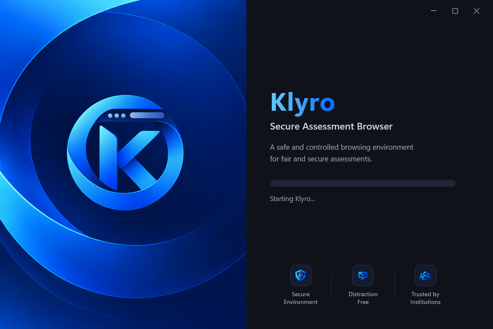
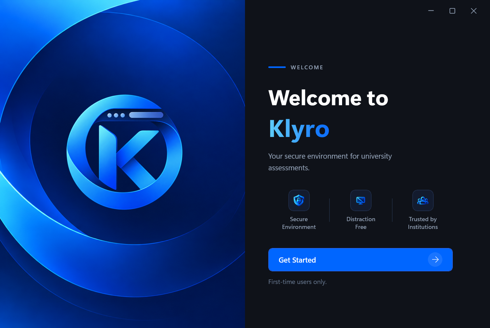
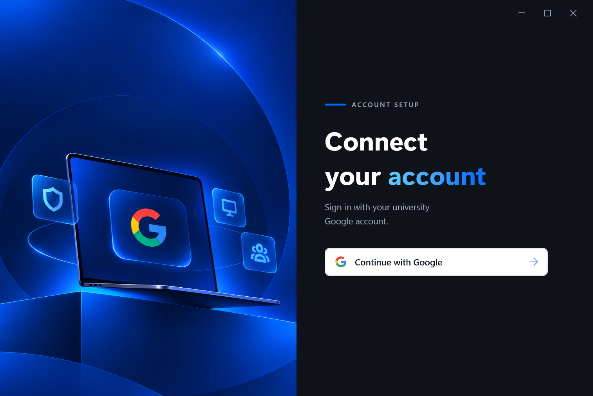
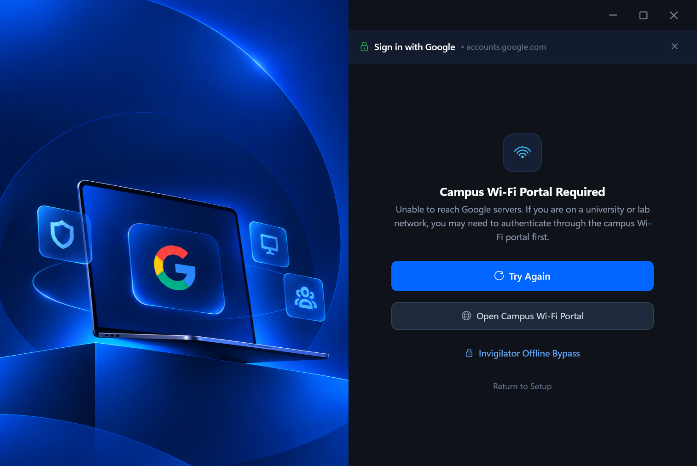
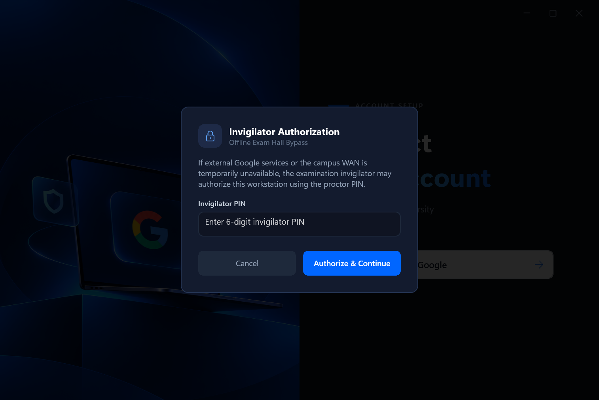
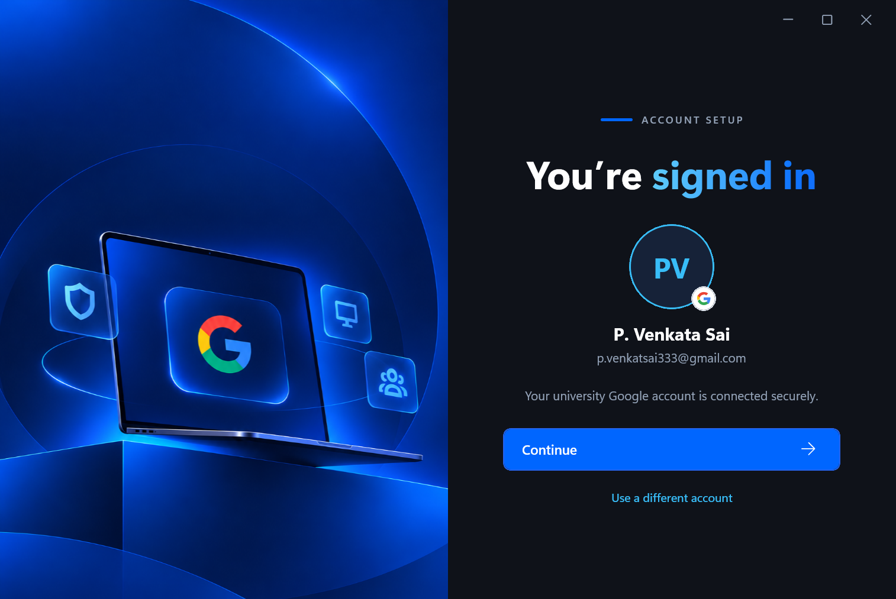
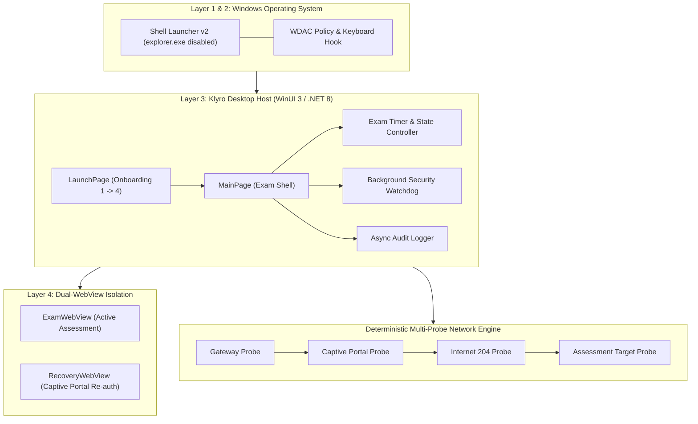

<div align="center">


# Klyro — Secure Assessment Browser

**Enterprise-Grade, Resilient Windows Kiosk Browser Engineered for High-Stakes Coding Examinations**

[](https://github.com/Venkatasai6789/Klyro/releases)
[](https://github.com/Venkatasai6789/Klyro)
[](https://dotnet.microsoft.com/)
[](https://learn.microsoft.com/en-us/windows/apps/winui/winui3/)
[-0078D7?logo=windows11)](https://www.microsoft.com/windows)
[](LICENSE)

<br />

<p align="center">
  <a href="#-quick-download--releases"><b>Download Binary</b></a> •
  <a href="#-user-interface-walkthrough"><b>Visual Tour</b></a> •
  <a href="#-key-architectural-features"><b>Key Features</b></a> •
  <a href="#-building-from-source"><b>Build Guide</b></a> •
  <a href="#-command-line-reference"><b>CLI Flags</b></a> •
  <a href="#-documentation"><b>Docs</b></a>
</p>

---

</div>

## 📌 Overview

**Klyro** is a production-hardened, tamper-resistant examination browser engineered specifically for academic institutions, universities, and competitive testing environments. 

Traditional lockdown browsers often crash, wipe written student source code, or lock out students when volatile campus Wi-Fi networks disconnect or captive portal leases expire. Klyro eliminates this critical vulnerability through a patent-grade **Dual-WebView State Isolation Architecture**, preserving written code in-place while providing seamless captive portal re-authentication, Google Workspace authentication, and proctor bypass mechanisms.

> **GitHub Repository:** [https://github.com/Venkatasai6789/Klyro.git](https://github.com/Venkatasai6789/Klyro.git)

---

## 🚀 Quick Download & Setup (Windows x64)

### 📦 Recommended: Standalone Windows Setup Installer
Download the official single-file installer executable directly via GitHub Releases:

💿 **[Download Klyro Setup Installer (`Klyro-Setup-v1.0.0-win-x64.exe`)](https://github.com/Venkatasai6789/Klyro/releases/latest)**

- **Single Self-Contained Executable**: Zero archive extraction or manual copying required. Simply run the installer executable to start the 4-step guided setup wizard.
- **Embedded Application Payload**: Full secure browser engine, assets, and runtime dependencies bundled inside the single `.exe`.
- **SHA-256 Checksum**: Cryptographically verifiable against supply-chain tampering.
- **Portable ZIP Alternative**: `Klyro-v1.0.0-win-x64.zip` is also provided for portable lab deployments.

---

## 💿 Software Installation Wizard (`Install-Klyro.ps1` & `Klyro.Setup.exe`)

When installing Klyro, candidates and system administrators are guided through a cohesive 4-step modern graphical installation wizard:

1. **Screen 01: License Agreement & Terms of Use**
   - Full scrollable Terms and Conditions (MIT Software License, Academic Assessment Integrity, Keyboard Suppression & Lockdown Policies, Dual-WebView Network Handling, and Zero-Telemetry Privacy Commitment).
   - Mandatory acceptance radial buttons:
     - `( ) I accept the terms in the License Agreement`
     - `(•) I do not accept the terms in the License Agreement` (Next button is strictly disabled until accepted).

2. **Screen 02: Installation Options & Shortcuts**
   - Target destination folder selection (defaults to `C:\Klyro` with real-time disk space calculation and folder browsing).
   - Shortcut creation radial buttons:
     - `(•) Create Desktop and Start Menu shortcuts (Recommended)`
     - `( ) Create Desktop shortcut only`
     - `( ) Create Start Menu shortcut only`
     - `( ) Do not create any shortcuts`
   - Automated file security: MOTW zone removal (`Zone.Identifier` unblocking) and Windows user access control permissions.

3. **Screen 03: Ready to Install & Live Progress**
   - Pre-install summary card displaying chosen target path, shortcut preferences, and security flags.
   - Prominent **Install** action button.
   - Smooth animated progress bar (0% $\rightarrow$ 100%) with real-time status ticker and live activity logging.

4. **Screen 04: Installation Completed**
   - Success badge and executable path confirmation.
   - Interactive checkbox: `[✓] Launch Klyro Secure Assessment Browser now`.
   - **Finish** button completing setup and seamlessly launching Klyro.

---

## 📸 User Interface Walkthrough

Klyro features a cohesive onboarding pipeline built with hardware-accelerated composition.

### Screen 01: Startup & Diagnostic Pipeline
*Sequential pre-flight health checks validating runtime environments, network latency, and security hooks (10% $\rightarrow$ 100% Ready).*

<div align="center">
  
</div>

---

### Screen 02: Welcome Experience
*Clear student briefing featuring security badges, testing rules, and an intuitive primary action flow.*

<div align="center">
  
</div>

---

### Screen 03: Google Account Setup & Authentication
*50/50 split layout featuring custom 3D hardware illustrations and official Google vector authentication.*

<div align="center">
  
</div>

#### Institutional Fallbacks & Invigilator Proctor Bypass
*If external Google services or the campus WAN are disrupted, Klyro delivers human-readable connection assistance cards, captive Wi-Fi portal navigation, and a proctor PIN authorization modal without displaying raw browser error codes.*

<div align="center">
  
  &nbsp;&nbsp;
  
</div>

---

### Screen 04: Google Account Connected
*Dynamic post-authentication confirmation screen reflecting the real authenticated student identity, smart initials fallback, and an interactive account switcher.*

<div align="center">
  
</div>

*Deterministic initials fallback (`PV`, `JD`, `AS`) automatically renders if the student's profile image is unavailable:*

<div align="center">
  
</div>

---

## 🛡️ Key Architectural Features

### 1. Dual-WebView Zero State-Loss Architecture
- **Primary Exam Context (`ExamWebView`)**: Hosts the coding platform (e.g. CodeChef, HackerRank, custom exam portals) under a strictly enforced canonical allowlist.
- **Secondary Recovery Context (`RecoveryWebView`)**: Instantiated on-demand in an isolated modal **only** when captive portal re-authentication is required.
- **Zero Loss Guarantee**: The primary browser context is frozen/blurred in-place; student code in the browser editor is never cleared, refreshed, or lost during network dropouts.

### 2. Deterministic Multi-Probe Network Health Engine
- Continuously probes four deterministic endpoints across dedicated worker threads:
  1. Default Gateway (`ARP / ICMP`)
  2. Campus Captive Portal (`http://172.16.103.254:8090/`)
  3. Internet Connectivity Probe (`https://www.gstatic.com/generate_204`)
  4. Assessment Target Endpoint (e.g., `codechef.com`)
- Damped state machine requires consecutive failures before triggering recovery, preventing UI disruption during transient Wi-Fi jitter.

### 3. Layered Kiosk Security (Defense-in-Depth)
- **Windows Shell Launcher v2**: Replaces `explorer.exe` on designated exam user accounts (`KLYRO-EXAM`), disabling task switching, desktop shells, and notification trays.
- **Windows Defender Application Control (WDAC)**: Hardware-enforced policy whitelisting only signed Klyro binaries and Microsoft WebView2 dependencies.
- **Low-Level Keyboard Hook**: Blocks disruptive and exploratory key combinations:
  - `Alt + Tab`, `Alt + Esc`, `Alt + Space`
  - `Windows Key`, `Ctrl + Esc`, `Ctrl + Shift + Esc`
  - `PrintScreen`, `Win + Shift + S`
- **Security Watchdog**: Dedicated high-priority background thread continuously inspecting the process table for disallowed tools (Cheat Engine, Wireshark, screen recorders, virtualization tools).
- **Fail-Closed Protocol & Navigation Guards**: Hard block on unapproved URI protocols (`file:`, `mailto:`, `ms-settings:`, `cmd:`, `powershell:`), popups, downloads, and external hyperlinks.

### 4. Ephemeral InPrivate Profiles & Privacy
- **Zero Local Data Retention**: Browser cache, cookies, passwords, and form submissions are isolated to ephemeral session profiles purged upon exit.
- **Automated PII Redaction**: Asynchronous audit logging channel (`klyro_audit_*.jsonl`) automatically sanitizes session tokens, credentials, and query parameters before writing to disk.

---

## 🏗️ Solution Architecture



---

## 💻 Building from Source

### Prerequisites
- **Operating System**: Windows 10 (Version 2004 / Build 19041+) or Windows 11
- **Developer Tools**:
  - [.NET 8.0 SDK](https://dotnet.microsoft.com/download/dotnet/8.0)
  - Visual Studio 2022 (with *Desktop development with .NET* and *Windows App SDK C# Templates*)
  - Windows 10/11 SDK (`10.0.26100.0` or higher)

### 1. Clone Repository
```powershell
git clone https://github.com/Venkatasai6789/Klyro.git
cd Klyro
```

### 2. Run Test Suite
Execute the 155 automated tests across unit, security, network, and recovery domains:
```powershell
dotnet test
```

### 3. Build & Package Standalone Release
Run the automated release packaging script:
```powershell
.\build-release.ps1 -Version "1.0.0"
```
The script will run the full test suite, compile the self-contained WinUI 3 binaries, and generate:
- `dist/Klyro-v1.0.0-win-x64/Klyro.App.exe`
- `dist/Klyro-v1.0.0-win-x64.zip`
- `dist/Klyro-v1.0.0-win-x64.zip.sha256`

---

## ⚙️ Command-Line Reference

Klyro provides fine-grained CLI arguments for institutional automation, proctor testing, and diagnostics:

| Flag | Description |
| :--- | :--- |
| `(None)` | Normal production startup (Screen 01 $\rightarrow$ Screen 02 $\rightarrow$ Screen 03 $\rightarrow$ Screen 04 $\rightarrow$ Assessment View). |
| `--screen1` / `--startup` | Directly forces Screen 01 (Startup & Diagnostic Pipeline). |
| `--screen2` / `--welcome` | Directly forces Screen 02 (Welcome & Feature Overview). |
| `--screen3` / `--account-setup` | Directly forces Screen 03 (Google Account Setup). |
| `--screen4` / `--account-connected` | Directly forces Screen 04 (Google Account Connected). |
| `--test-user-name "<Name>"` | Overrides display name for testing Screen 04 rendering. |
| `--test-user-email "<Email>"` | Overrides email address for testing Screen 04 rendering. |
| `--reset` / `--reset-browser` | Purges all cached cookies, persistent profiles, and onboarding state, restoring first-time user status. |
| `--config <path>` | Specifies a custom JSON configuration file (e.g. `config/exam.json`). |
| `--dry-run` | Validates configuration integrity and executes pre-flight checks without locking down the desktop shell. |

---

## 📂 Repository Structure

```
Klyro/
├── .github/
│   └── workflows/
│       └── release.yml             # GitHub Actions automated release pipeline
├── config/
│   ├── default.json                # Production exam configuration
│   ├── development.json            # Development profile with verbose telemetry
│   └── exam.example.json           # Institutional template
├── docs/
│   ├── assets/                     # Official brand logo & UI progression screenshots
│   ├── Architecture.md             # System architecture & defense-in-depth specification
│   ├── ThreatModel.md              # STRIDE threat model & mitigations (T1-T15)
│   ├── NetworkRecovery.md          # Multi-probe network state machine specification
│   ├── Deployment.md               # IT Admin provisioning: Shell Launcher, Intune, WDAC
│   └── Troubleshooting.md          # Invigilator & proctor quick triage guide
├── src/
│   ├── Klyro.Core/                 # Core domain logic, network probes, guards, logging (.NET 8)
│   ├── Klyro.App/                  # WinUI 3 desktop application & dual-WebView host
│   ├── Klyro.Admin/                # Command-line administrative diagnostics & telemetry tool
│   └── Klyro.Installer/            # Modern WPF Setup Wizard, Shell Launcher v2, WDAC & assigned access scripts
├── tests/
│   ├── Klyro.UnitTests/            # Preflight checks, timer, session recovery, audit logger
│   ├── Klyro.InstallerTests/       # Installer options, radio button states, and EULA compliance tests
│   ├── Klyro.SecurityTests/        # Allowlist filters, protocol blocks, download guards
│   ├── Klyro.NetworkTests/         # Deterministic probes, latency damping, Wi-Fi service
│   └── Klyro.RecoveryTests/        # Captive portal recovery controller & modal lifecycle
├── build-release.ps1               # Production win-x64 release packaging script
├── CHANGELOG.md                    # Release history adhering to Keep a Changelog
└── README.md                       # Product documentation
```

---

## 📑 Documentation

Deep-dive documentation is available in the [`docs/`](docs/) directory:

- 📐 [**Architecture Guide**](docs/Architecture.md) — Comprehensive technical design and security boundary specifications.
- 🛡️ [**Threat Model**](docs/ThreatModel.md) — STRIDE security assessment, attack surfaces, and countermeasures.
- 🌐 [**Network Recovery Engine**](docs/NetworkRecovery.md) — Deterministic multi-probe state machine and recovery algorithm.
- 🚀 [**Deployment & Provisioning**](docs/Deployment.md) — Kiosk setup, Shell Launcher v2 configuration, and WDAC policies.
- 🩺 [**Troubleshooting & Proctor Guide**](docs/Troubleshooting.md) — Invigilator triage, offline bypass, and error resolution.
- 📜 [**Changelog**](CHANGELOG.md) — Complete version release history and release notes.

---

## 🔒 Security & Vulnerability Reporting

Security is foundational to Klyro. If you discover a potential vulnerability, security bypass, or kiosk breakout vector, please **do not open a public issue**. Instead, review our security guidelines and contact the security maintainers directly.

---

## 📄 License

This project is licensed under the **MIT License** — see the [LICENSE](LICENSE) file for details.

<div align="center">
  <sub>Built with ❤️ for universities and academic integrity. Maintained at <a href="https://github.com/Venkatasai6789/Klyro">Venkatasai6789/Klyro</a>.</sub>
</div>
