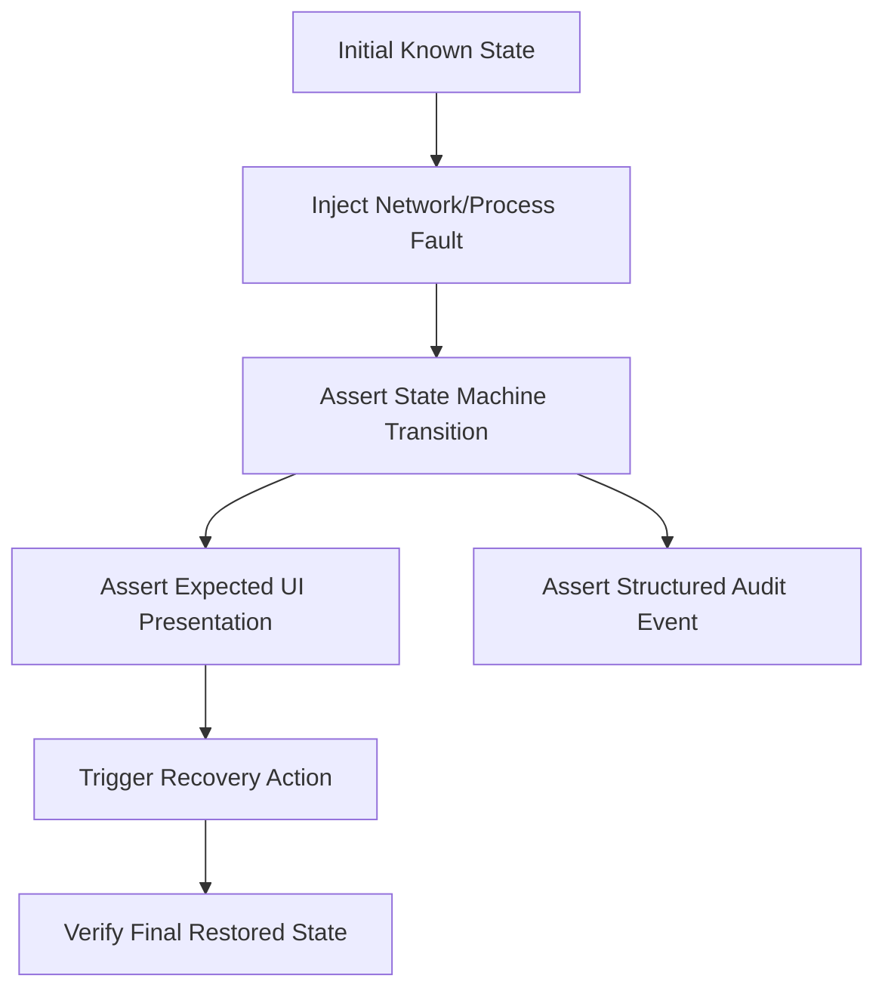

# Klyro: Comprehensive Testing Matrix & Chaos Verification Suite

## 1. Overview & Test Strategy

Testing Klyro requires a rigorous, multi-tiered approach covering:
1. **Automated Unit & Security Tests**: Fast, deterministic headless tests validating configuration validation, allowlist regex/URI logic, protocol blocking, and state machines.
2. **Mock Network & Simulation Tests**: Verifying network multi-probe scoring, threshold damping, and captive portal detection without touching physical network hardware.
3. **Chaos & Resilience Tests**: Injected crash, power-cycle, packet drop, and latency scenarios.
4. **OS Lockdown & Shortcut Tests**: Verifying operating system enforcement under Windows Assigned Access / Shell Launcher v2.

---

## 2. Failure Scenario Matrix (Scenarios 1–16)

| Scenario ID | Test Scenario | Trigger / Injection | Expected State | Expected UI Behavior | Expected Audit Log | Recovery Action |
|---|---|---|---|---|---|---|
| **S1** | Normal Exam Flow | Baseline launch on healthy network | `ONLINE` / `ACTIVE` | Pre-flight passes; CodeChef loads fullscreen. Green dot indicator. | `EXAM_STARTED` | N/A |
| **S2** | Captive Portal Expiration | Campus Wi-Fi auth lease expires (HTTP 204 fails; 172.16.103.254 responds) | `PORTAL_REQUIRED` | `ExamWebViewHost` pauses/dims. Modal `RecoveryWebViewHost` appears with portal login. | `CAPTIVE_PORTAL_DETECTED`, `RECOVERY_UI_SHOWN` | Student submits credentials. |
| **S3** | Authentication Success | Student submits valid credentials on portal | `ONLINE` | Modal overlay indicates "Verifying..."; verifies 204; closes. Exam resumes. | `PORTAL_AUTH_SUCCESS`, `NETWORK_RESTORED`, `EXAM_RESUMED` | Full opacity restored to CodeChef editor. |
| **S4** | Wrong Portal Password | Student submits invalid credentials on portal | `PORTAL_REQUIRED` | Portal displays error message inside modal. Modal remains open; no escape. | `PORTAL_AUTH_FAILED` | Student re-enters credentials. |
| **S5** | Captive Portal Down | Gateway up, but portal IP 172.16.103.254 times out | `DEGRADED` / `PORTAL_UNAVAILABLE` | Exam paused; modal displays "University Network Unavailable — Contact Invigilator". | `PORTAL_UNREACHABLE` | Retry button / invigilator intervention. |
| **S6** | Wi-Fi Disconnected | Wi-Fi adapter turned off or radio disconnected | `OFFLINE` | Exam paused; subtle top bar: "Network Disconnected — Searching for Wi-Fi". No portal modal. | `NETWORK_LOST`, `ADAPTER_OFFLINE` | Reconnects automatically when signal returns. |
| **S7** | High Latency / Slow Network | Probe latency rises to 2500ms; single packet loss | `DEGRADED` | Subtle amber dot indicator. Exam does NOT pop up portal or interrupt typing. | `NETWORK_DEGRADED` | Restores to `ONLINE` once latency normalizes. |
| **S8** | CodeChef Outage | Internet 204 works; CodeChef returns HTTP 500/503 | `ASSESSMENT_SERVICE_UNAVAILABLE` | Non-intrusive banner: "Assessment Service Unavailable — Work Preserved. Do not refresh." | `ASSESSMENT_SERVICE_DOWN` | Auto-polls CodeChef endpoint in background. |
| **S9** | WebView2 Crash | Terminate `msedgewebview2.exe` process via taskkill | `RECOVERY_REQUIRED` | Screen dims briefly; WebView instance reinitializes; restores contest URL. | `WEBVIEW_CRASH`, `WEBVIEW_REINITIALIZED` | Student work restored from local session store. |
| **S10** | Klyro App Crash | Force terminate `Klyro.App.exe` | `STARTING` -> `RESTORE` | Windows Shell Launcher restarts Klyro within <2s. Pre-flight skips directly to resume. | `KLYRO_CRASH_DETECTED`, `EXAM_SESSION_RESTORED` | Session ID preserved; re-enters active exam. |
| **S11** | Workstation Reboot | Hard power cycle or Windows restart | `STARTING` -> `RESTORE` | OS auto-logs in `KLYRO-EXAM`; Shell Launcher starts Klyro; restores contest. | `SYSTEM_REBOOT_DETECTED`, `EXAM_SESSION_RESTORED` | Restores contest URL; prompts invigilator code if configured. |
| **S12** | New Window / Tab Attempt | Link with `target="_blank"` or `window.open()` clicked | `ACTIVE` | Window open request cancelled. No new window or tab appears. | `POPUP_BLOCKED` | Main page remains undisturbed. |
| **S13** | External URL Attempt | Hyperlink clicked pointing to `google.com` or `github.com` | `ACTIVE` | Navigation cancelled immediately. Student remains on CodeChef. | `NAVIGATION_BLOCKED: https://google.com` | Navigation cancelled (`e.Cancel = true`). |
| **S14** | External Protocol Attempt | Hyperlink clicked to `mailto:`, `file:`, or `ms-settings:` | `ACTIVE` | Protocol launch cancelled immediately. No Windows dialog opens. | `PROTOCOL_BLOCKED: ms-settings:` | Intercepted by `ProtocolGuard`. |
| **S15** | Download Attempt | Link or script triggers file download | `ACTIVE` | Download cancelled silently or unobtrusive notification shown. | `DOWNLOAD_BLOCKED: file.zip` | Intercepted by `DownloadGuard`. |
| **S16** | Malformed Portal Redirect | Captive portal attempts redirect to external search engine | `PORTAL_REQUIRED` | Redirect navigation cancelled by `RecoveryNavigationGuard`. | `RECOVERY_NAVIGATION_BLOCKED` | Stays on approved portal host. |

---

## 3. Chaos Test Suite Matrix

Every chaos test must execute deterministically against the test harness:



| Chaos Test Case | Injected Fault | Test Verification Method | Pass Criteria |
|---|---|---|---|
| **C1: Flapping Radio** | Rapid Wi-Fi link drops every 1.5s | `INetworkSimulator.SetCondition(Flapping)` | Threshold damping prevents UI modal flapping. State oscillates only between `ONLINE` and `DEGRADED`. |
| **C2: Blackhole DNS** | DNS queries to external hosts return NXDOMAIN | `INetworkSimulator.SetCondition(DnsFailure)` | Probes detect failure; classifies appropriately as `OFFLINE` or `DEGRADED`. |
| **C3: Slow Portal Response** | Portal probe responds with 8000ms delay | `INetworkSimulator.SetCondition(PortalTimeout)` | Probe timeout kicks in at 1500ms; UI does not freeze; thread does not block. |
| **C4: Partial Authentication** | Portal returns 200, but upstream firewall drops 204 | Mock Portal returns OK; Mock 204 drops | Recovery UI displays "Connection verifying..." and does not dismiss until 204 passes. |
| **C5: Renderer OOM** | Stress memory inside WebView2 | Send OOM command to WebView | `ProcessFailed` handler catches event, logs, and seamlessly reinitializes. |

---

## 4. Security & Keyboard Policy Matrix

| Keyboard Chord | Threat | Native Shell Result | Assigned Access / Kiosk Result | Pass Criteria |
|---|---|---|---|---|
| **Alt + Tab** | Switch to another window | Window un-switchable | Suppressed by Shell Launcher / Keyboard Filter | Desktop/other apps never visible |
| **Win + D** | Minimize all to show desktop | Shell is full screen | Explorer shell not running | Desktop never exposed |
| **Win + R** | Launch Run dialog | Run dialog blocked | Explorer shell not running; Run blocked | No command prompt access |
| **Ctrl + Shift + Esc**| Open Task Manager | Blocked by policy | Disabled by GPO / Registry policy | Task Manager cannot start |
| **Ctrl + Alt + Delete**| Security options screen | Switch user disabled | Lock / Switch user removed via GPO | Screen restricted to logoff |
| **F11 / F12** | Enter windowed mode / DevTools | Handled by WinUI & WV2 | `AreDevToolsEnabled = false` | DevTools window never opens |
| **Ctrl + L / Ctrl + T**| Address bar / New tab | No browser chrome | No action in Klyro shell | Keystroke consumed/ignored |
| **Right Click** | Context menu inspection | `AreDefaultContextMenusEnabled = false` | No context menu displayed | Context menu never opens |

---

## 5. Automated Test Projects Structure

```
tests/
├── Klyro.UnitTests/
│   ├── ConfigurationValidatorTests.cs   // Validates rejection of wildcards, malformed URLs
│   ├── ExamTimerTests.cs                // Tests Pause vs Continue policies
│   ├── SessionStoreTests.cs             // Verifies serialization/encryption of recovery state
│   └── AllowlistManagerTests.cs         // Verifies lookalike domain rejection
│
├── Klyro.SecurityTests/
│   ├── NavigationGuardTests.cs          // Main-frame navigation permit/deny
│   ├── FrameNavigationGuardTests.cs     // Iframe navigation permit/deny
│   ├── PopupGuardTests.cs               // NewWindowRequested interception
│   ├── ProtocolGuardTests.cs            // file://, mailto:, ms-settings: rejection
│   └── DownloadGuardTests.cs            // Download interception
│
├── Klyro.NetworkTests/
│   ├── ConnectivityProbeTests.cs        // Probe timeout and socket handling
│   ├── CaptivePortalDetectorTests.cs    // Truth table evaluation
│   ├── NetworkStateMachineTests.cs      // State transitions and damping
│   └── NetworkSimulatorTests.cs         // Mock chaos conditions
│
└── Klyro.RecoveryTests/
    ├── RecoveryControllerTests.cs       // Modal overlay triggers
    ├── PortalAuthenticationMonitorTests.cs // Auth verification sequence
    └── RecoveryAllowlistTests.cs        // Captive portal URL containment
```
